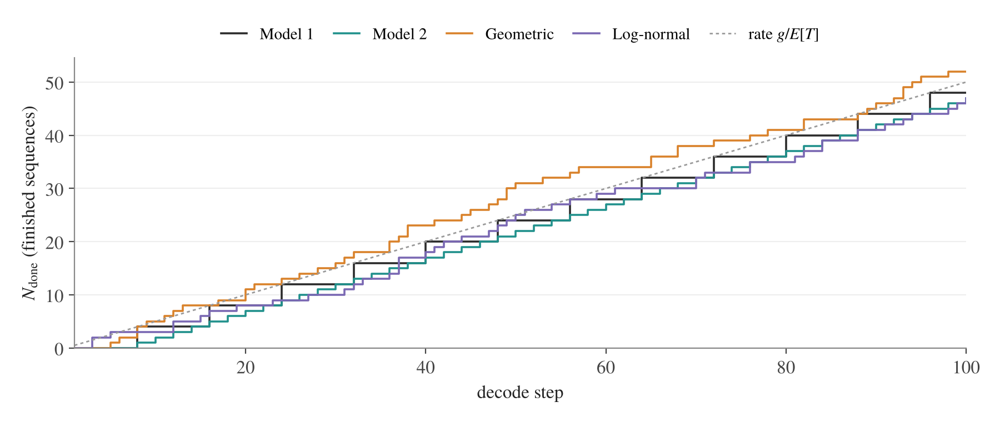
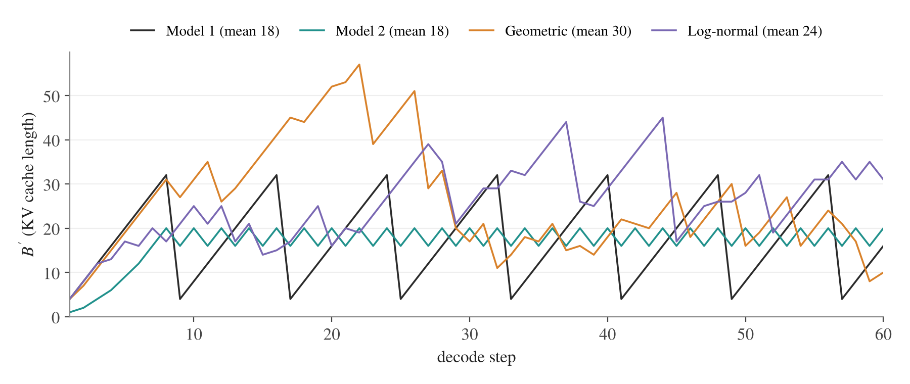

# Appendix

## 1. About the use of AI assistants

The tone, content, structure, modeling arguments of this document are mine. AI-assistants (Opus, Astra & Sol) were used to:

- Help formalizing some mathematical arguments (eg section 3 - staleness argument coming from Little law) and derived the entire proof of section 4 (the definition of the optimization problem is mine, and we worked together for the sketch of the proof; the rest of the derivations are fully done by Opus, Astra & Sol).
- Check grammar, correctness and performed minor writing edits for the main document.
- Build all companion code - python functions, visuals, numerical applications.
- **Write (almost) the entire appendix, under my direction. The language is a little more mechanistic than mine, yet I believe the appendix is mostly clear (and not meant for a first read).**
- Setup quarto and deploy the GitHub pages version.

## 2. Additional setup details

Sections 2–4 derive the cost model used in [the article](main.md). Sections 5–6 derive the arrival-time model and the allocation.

### Model and workload

We count BF16 text transformer blocks. One multiply-add is two FLOPs.

| Symbol | Meaning |
|---|---|
| $L,D,F$ | Layer count, hidden width, gated-MLP width |
| $N_Q,N_{KV},d$ | Query heads, KV heads, head dimension |
| $D_Q=N_Qd$, $D'=N_{KV}d$ | Query and KV widths; $D_Q$ can differ from $D$ |
| $P=L(3DF+2DD_Q+2DD')$ | Block parameters: three MLP projections, query/output projections, key/value projections |
| $\kappa=4LD'$ | Full-attention KV bytes per token: K and V, $D'$ values each, two bytes per value, $L$ layers |
| $X=\lvert x\rvert$, $T$, $\ell=X+T$ | Prompt, response and completed total lengths |
| $S=X+A$, $B'=\sum_{g=1}^{B}S_g$ | Cache length at age $A$; total cached positions in a replica |
| $B$, $N_{\text{seq}}$, $n_{\mathrm{ep}}$ | Sampler batch per replica, fresh training batch, epochs per fresh batch |
| $s,u$ | Sampler TP size, trainer TP+SP size |
| $n_s=n_{\text{samp}}=n_{rep}s$, $n_t=n_{\text{train}}=n_{DP}u$, $N$ | Sampler GPUs, trainer GPUs, total GPU budget |

$P$ excludes embeddings, the LM head, norms and biases. Training includes prompt computation even when the loss masks prompt tokens. See [Scaling Book, Ch. 4](https://jax-ml.github.io/scaling-book/transformers/) for transformer counts. Each rollout counts once toward fresh throughput, even if training reuses it for several epochs.

### Hardware and units

Per GPU, $C$ is dense BF16 FLOP/s, $W$ is HBM bandwidth and $H$ is the memory budget. $W_{\text{ici}}$ is one-way interconnect bandwidth; $W_{\text{link}}$ is effective receiving bandwidth for weights. GB and TB are decimal; KiB is 1,024 bytes.

| Preset | $C$, TFLOP/s | $W$, TB/s | Physical HBM, GB | $W_{\text{ici}}$, GB/s | $W_{\text{link}}$, GB/s |
|---|---:|---:|---:|---:|---:|
| H100 SXM | 989.5 | 3.35 | 80 | 450 | 50 |
| H200 SXM | 989.5 | 4.8 | 141 | 450 | 50 |
| B200 SXM | 2,250 | 8 | 180 | 900 | 50 |

The presets use [eight-GPU HGX configurations](https://docs.nvidia.com/enterprise-reference-architectures/hgx-ai-factory-h100-h200-b200/latest/components.html). $W_{\text{ici}}$ is half the advertised bidirectional NVLink bandwidth. The 50 GB/s weight-transfer rate is a model input. Examples reserve 10% of physical HBM: $H=0.9\,\mathrm{HBM}_{\text{physical}}$.

### Roofline method

For $F_{\text{ops}}$ FLOPs and $V$ bytes of HBM traffic,

$$
T_{\text{kernel}}\approx\max\left(\frac{F_{\text{ops}}}{C},\frac{V}{W}\right).
$$

The kernel is compute bound when $F_{\text{ops}}/V>C/W$ (about 295 FLOP/byte on H100). We add successive kernel times and exposed communication times. See [Scaling Book, Ch. 1](https://jax-ml.github.io/scaling-book/roofline/) and Section 7 for the assumptions.

## 3. Sampler time formula

### One decode step

A replica generates one token for each of its $B$ active sequences.

**Linear layers.** Each weight contributes two FLOPs per token and is read once per step: $F_{\text{ops}}=2BP$, $V=2P$. Thus $T_{\text{linear}}\approx\max(2BP/C,2P/W)$, with crossover at $B=C/W$.

**Attention.** A query head reads $S$ positions. Scores and weighted values cost $4dS$ FLOPs. Across the replica, $F_{\text{attention}}\approx4LD_QB'$ and $V_{KV}\approx\kappa B'$. The intensity is $N_Q/N_{KV}$, well below $C/W$ for these checkpoints, so attention is memory bound. This assumes reuse of shared KV heads; it omits new KV writes and query/output traffic ([Scaling Book, Ch. 7](https://jax-ml.github.io/scaling-book/inference/)).

**TP.** Each GPU holds $1/s$ of the weights and KV heads. Each layer has two all-reduces of $2BD$ bytes. A ring all-reduce sends $2(s-1)/s$ message volumes per GPU, giving $8LBD(s-1)/s$ bytes per step ([Scaling Book, Ch. 3](https://jax-ml.github.io/scaling-book/sharding/)). With one-way bandwidth and no overlap,

$$
\boxed{
T_{\text{step}}(B,B',s)=
\max\left(\frac{2BP}{sC},\frac{2P}{sW}\right)
+\frac{\kappa B'}{sW}
+\frac{8LBD(s-1)}{sW_{\text{ici}}}.
}
\tag{A3.1}
$$

### From decode steps to fresh batches

One replica completes $B/\mathbb E[T]$ sequences per decode step on average. Independent replicas add their wall-clock rates. At fixed $B,s$, A3.1 is affine in $B'$, so its mean step time is $T_{\text{step}}(B,B\mathbb E[S],s)$. The long-run time per fresh batch is

$$
\boxed{
T_{\text{sampler}}
=\frac{N_{\text{seq}}\mathbb E[T]}{n_{rep}B}
T_{\text{step}}(B,B\mathbb E[S],s)
=\frac{N_{\text{seq}}w_s(B)}{n_{\text{samp}}},
}
\tag{A3.2}
$$

where $\mathbb E[S]=X+\mathbb E[T(T+1)]/(2\mathbb E[T])$ (Section 5), and

$$
w_s(B)=\mathbb E[T]\left[
\max\left(\frac{2P}{C},\frac{2P}{BW}\right)
+\frac{\kappa\mathbb E[S]}{W}
+\frac{8LD(s-1)}{W_{\text{ici}}}
\right].
\tag{A3.3}
$$

$w_s$ is GPU-seconds per fresh sequence. The cache average is over decode steps; wall-clock snapshots give more weight to slow steps. Finite batches can differ: a synchronized batch from an empty system needs $\lceil N_{\text{seq}}/(n_{rep}B)\rceil$ whole rounds.

### Sampler memory

Weights and KV must fit:

$$
\frac{2P+\kappa B'_{\text{budget}}}{s}\le H.
\tag{A3.4}
$$

| Response model (article, Section 1.3) | Cache budget $B'_{\text{budget}}$ |
|---|---|
| 1. Synchronized, length $J$ | Peak $B(X+J)$ |
| 2. Staggered, length $J$ | Mean $B[X+(J+1)/2]$ |
| 3–4. Random lengths | $B\mathbb E[S]+z\sqrt{B\operatorname{Var}(S)}$, $z=3$, independent stationary slots |

For $b$ equal staggered cohorts ($b\mid B$, $b\mid J$), the exact peak is

$$
\frac Bb\sum_{i=1}^{b}(X+iJ/b)=B\left[X+\frac{J(b+1)}{2b}\right].
$$

The gap above the mean is $B[J/(2b)-1/2]$, at most about $1/b$ of the generated cache (1.56% for $b=64$). The mean and random reserve do not guarantee peak feasibility; the synchronized and exact cohort peaks do under the model.

### Quantized weights and KV cache

Let $b_w,b_{KV}$ be bytes per weight and per K/V element. Replace $2P$ by $b_wP$ and $\kappa$ by $\kappa_q=2b_{KV}LD'$. Then

$$
T_{\text{step},q}\approx
\max\left(\frac{2BP}{sC_q},\frac{b_wP}{sW}\right)
+\frac{\kappa_qB'}{sW}
+\frac{8LBD(s-1)}{sW_{\text{ici}}},
\qquad
\frac{b_wP+\kappa_qB'_{\text{budget}}}{s}+M_{q,\text{GPU}}\le H.
$$

$C_q$ describes the kernel's actual arithmetic. $M_{q,\text{GPU}}$ covers metadata and scratch space. TP activations remain BF16 here. Measure conversion overhead and check the attention compute floor $4LD_QB'/(sC_{\text{attn},q})$, where $C_{\text{attn},q}$ is the attention kernel's FLOP/s. Halving KV bytes need not halve total memory or time. See [vLLM](https://docs.vllm.ai/en/latest/features/quantization/quantized_kvcache/) and [TensorRT-LLM](https://nvidia.github.io/TensorRT-LLM/1.1.0/features/quantization.html). The arrival model still applies if the length law is unchanged.

### Local-attention layers

With $L_g$ global layers and $L_w$ local layers of window $w$, the BF16 cache bytes for one sequence are

$$
v_{KV}(S)=4D'\left[L_gS+L_w\min(S,w)\right].
\tag{A3.5}
$$

Use $B\mathbb E[v_{KV}(S)]$ for KV reads, and add $z\sqrt{B\operatorname{Var}(v_{KV}(S))}$ for random-length memory. For fixed cohorts, use their mean or peak. This assumes the engine releases entries outside the window.

## 4. Trainer time formula

### Linear layers and attention

A matrix with $P$ weights costs $2P$ FLOPs per token in the forward. Input and weight gradients cost another $4P$. Each extra forward adds $2P$.

One causal-attention forward costs $\sum_{j=1}^{\ell}4D_Qj=2D_Q\ell(\ell+1)$ per layer. FlashAttention backward has five matrix products: recomputed scores, then $dV,dP,dQ,dK$, against two in the forward ([Algorithm 2](https://arxiv.org/pdf/2307.08691)). Its matrix work costs 2.5 forwards.

Let $c=3$ for forward plus backward in the linear layers, plus one per extra forward. Attention therefore has $c+0.5$ forward-equivalents. At leading order,

$$
F_{\text{train}}(\ell)
\approx2cP\ell+(2c+1)LD_Q\ell^2.
\tag{A4.1}
$$

Full activation recompute gives $c=4$. The code retains the diagonal and local windows through the pair count

$$
\mathcal A(\ell)=L_g\frac{\ell(\ell+1)}2+L_w a_w(\ell),
\qquad
a_w(\ell)=
\begin{cases}
\ell(\ell+1)/2,&\ell\le w,\\
w(w+1)/2+(\ell-w)w,&\ell>w.
\end{cases}
$$

Use $2(2c+1)D_Q\mathbb E[\mathcal A(\ell)]$ for attention FLOPs per sequence. For full attention, this is $(2c+1)LD_Q\mathbb E[\ell(\ell+1)]$.

### Data parallelism, TP and SP

Assume even work across $n_{DP}$ ranks and hidden FSDP traffic. Then $n_t=n_{DP}u$ GPUs share the compute work $N_{\text{seq}}\mathbb E[F_{\text{train}}(\ell)]/C$ per epoch.

With TP+SP, each layer all-gathers before attention and the MLP, then reduce-scatters their outputs. Each of these four collectives sends $(u-1)/u$ of a BF16 $[t,D]$ tensor per GPU. That gives $8tD(u-1)/u$ bytes per layer and pass. Full recompute has three passes: forward, backward and recompute ([Korthikanti et al.](https://arxiv.org/abs/2205.05198)). With $t\approx N_{\text{seq}}\mathbb E[\ell]/n_{DP}$,

$$
\boxed{
T_{\text{train}}=\frac{N_{\text{seq}}w_t}{n_{\text{train}}},
\quad
w_t=n_{\mathrm{ep}}\left[
\frac{2cP\mathbb E[\ell]+(2c+1)LD_Q\mathbb E[\ell^2]}{C}
+\frac{8(c-1)LD\mathbb E[\ell](u-1)}{W_{\text{ici}}}
\right].
}
\tag{A4.2}
$$

Use the pair count above for exact attention. Training is compute bound in this model.

**Extra passes.** A reference- or old-policy forward computed once per fresh batch belongs outside the epoch multiplier: $w_t=n_{\mathrm{ep}}w_{\text{epoch}}+w_{\text{once-per-batch}}$. One full forward adds

$$
\boxed{
w_{\text{extra forward}}=
\frac{2P\mathbb E[\ell]+2LD_Q\mathbb E[\ell^2]}{C}
+\frac{8LD\mathbb E[\ell](u-1)}{W_{\text{ici}}}.
}
\tag{A4.4}
$$

For exact attention, replace $2LD_Q\mathbb E[\ell^2]$ by $4D_Q\mathbb E[\mathcal A(\ell)]$. Apply the trainer-efficiency correction to this work too. The current solvers omit these passes; a separate reference-model pool also needs its own memory and capacity.

### Stored state and activation memory

The Adam budget is BF16 weights and gradients ($4P$), FP32 master weights ($4P$) and FP32 moments ($8P$): $16P$ bytes. FSDP+TP divides it by $n_{DP}u$.

The saved BF16 activations for one layer, per token, are:

| Tensors | Bytes |
|---|---:|
| Attention and MLP norm inputs/outputs | $8D$ |
| Queries, keys, values and attention output | $4D_Q+4D'$ |
| Gate and up outputs, their product | $6F$ |
| **Total $a$** | $8D+4D_Q+4D'+6F$ |

The gate nonlinearity is fused or recomputed; saving it adds $2F$. Full recompute keeps block inputs ($2LD$) plus one reconstructed layer ($a$), instead of $La$ per token ([Ultra-Scale Playbook](https://huggingface.co/spaces/nanotron/ultrascale-playbook), “Activation recomputation”). For $M_\mu$ tokens per micro-batch,

$$
\boxed{
\mathrm{Mem}_{\text{train}}\approx
\frac{16P}{n_{DP}u}+\frac{(2LD+a)M_\mu}{u}\le H.
}
\tag{A4.3}
$$

Here $M_\mu=b_\mu(X+T_{\max})$ for $b_\mu$ sequences per micro-batch, each at the maximum total length; the code uses $b_\mu=1$. DP divides the training batch; $b_\mu$ controls how much one rank holds at once. Section 7 lists omitted allocations.

### When can FSDP traffic be hidden?

For TP size one, backward compute is about $4Pt/C$ for $t$ tokens. A BF16 parameter all-gather and gradient reduce-scatter each transfer about $2P$ bytes per GPU for a large DP group, giving $4P/W_{\text{network}}$ seconds. Comparing them gives the scale $t\gtrsim C/W_{\text{network}}$: about 2,200 tokens over H100 NVLink and 20,000 at 50 GB/s. TP, checkpointing and collective scheduling change this estimate. Measure exposed traffic before assuming full overlap ([Scaling Book, Ch. 5](https://jax-ml.github.io/scaling-book/training/)).

## 5. Arrival-time formalism

### Response lengths and EOS

For a fixed prompt $x$ and policy, the uncapped EOS length has distribution

$$
\Pr(T=t\mid x)=\sum_{y_{<t}\ \text{without EOS}}
\pi(y_{<t}\mid x)\,\pi(y_t=\mathrm{EOS}\mid x,y_{<t}).
$$

The conditional EOS probability is a prefix-dependent hazard; a constant hazard gives the geometric law (Model 3). We estimate the length law from rollouts. With cap $M$, $T=\min(T_{\mathrm{EOS}},M)$: probability beyond $M$ goes to $M$, which counts as completion.

### Renewal process and cache age

Slot $g$ runs consecutive sequences with i.i.d. prompt/length pairs and no idle steps. Define

$$
\tau_{g,1}=0,\qquad \tau_{g,k+1}=\tau_{g,k}+T_{g,k},\qquad
k_g(j)=\max\{k:\tau_{g,k}\le j\}.
$$

At decode step $j$, its age is $A_g(j)=j-\tau_{g,k_g(j)}+1$ and its cache length is $S_g(j)=|x_{g,k_g(j)}|+A_g(j)$. We count after token insertion, before freeing a completed sequence.

A sequence of length $t$ visits each age $1,\dots,t$ once. Over many sequences, the fraction of steps at age $j$ is therefore

$$
\boxed{\Pr(A=j)=\frac{\Pr(T\ge j)}{\mathbb E[T]}.}
\tag{A5.1}
$$

Long sequences occupy the slot for more steps, so an observed active sequence is length-biased. Summing the ages visited in each sequence and dividing by the mean sequence length gives

$$
\mathbb E[A]=\frac{\mathbb E[\sum_{j=1}^Tj]}{\mathbb E[T]}
=\frac{\mathbb E[T(T+1)]}{2\mathbb E[T]},
$$

$$
\mathbb E[A^2]
=\frac{\mathbb E[T(T+1)(2T+1)]}{6\mathbb E[T]},
\qquad
\operatorname{Var}(A)=\mathbb E[A^2]-\mathbb E[A]^2.
\tag{A5.2}
$$

For fixed $X$, $\mathbb E[S]=X+\mathbb E[A]$ and $\operatorname{Var}(S)=\operatorname{Var}(A)$. Mean cache needs the second response moment; its variance needs the third. These time averages require finite moments. Convergence at a fixed step also needs aperiodicity; fixed lengths remain periodic ([Gallager, Ch. 4](https://ocw.mit.edu/courses/6-262-discrete-stochastic-processes-spring-2011/931ffa0940899c27f34b71ad64fd2bb0_MIT6_262S11_chap04.pdf)).

### Variable prompts and dependence

For new prompts drawn from $\mathcal D$, an active slot is biased toward prompts with longer responses:

$$
\Pr(x^*=x)=\frac{\mathcal D(x)\mathbb E[T\mid x]}{\mathbb E[T]},\qquad
\Pr(A=j\mid x^*=x)=\frac{\Pr(T\ge j\mid x)}{\mathbb E[T\mid x]}.
$$

Consequently,

$$
\boxed{
\mathbb E[S]=\frac{\mathbb E[XT]}{\mathbb E[T]}
+\frac{\mathbb E[T(T+1)]}{2\mathbb E[T]}.
}
\tag{A5.3}
$$

The expectations on the right concern newly started sequences. If $X,T$ are independent, the first term is $\mathbb E[X]$. More generally, for any cache-byte function $v$,

$$
\mathbb E_{\text{slot}}[v(S)]
=\frac{\mathbb E[\sum_{j=1}^{T}v(X+j)]}{\mathbb E[T]}.
\tag{A5.4}
$$

The code uses this formula with a fixed prompt length and the checkpoint's KV function.

### The four response models

The uncapped single-slot moments are:

| Model | $\mathbb E[T]$ | $\mathbb E[A]$ | $\operatorname{Var}(A)$ |
|---|---:|---:|---:|
| 1–2. Fixed length $J$ | $J$ | $(J+1)/2$ | $(J^2-1)/12$ |
| 3. Geometric, $\Pr(T=t)=p(1-p)^{t-1}$ | $1/p$ | $1/p$ | $(1-p)/p^2$ |

Models 1–2 differ in their joint phases, not their single-slot averages. Their slots are dependent. At equal mean $J$, the geometric law uses $2J/(J+1)$ times the generated cache of fixed lengths, approaching two. Prompts and caps change the total-cache ratio.

**Model 4** rounds and caps a log-normal variable, with $Z\sim\mathcal N(m,\sigma^2)$:

$$
T=\min\left(M,\max\left(1,\left\lfloor e^Z+\tfrac12\right\rfloor\right)\right).
$$

For either capped random law, set $s_j=\Pr(T\ge j)$. Geometric survival is $s_j=(1-p)^{j-1}$ for $1\le j\le M$. Log-normal survival is $s_1=1$ and

$$
s_j=1-\Phi\left(\frac{\log(j-1/2)-m}{\sigma}\right),\quad 2\le j\le M.
$$

The capped moments follow by summing survival probabilities:

$$
\mathbb E[T]=\sum_{j=1}^{M}s_j,\quad
\mathbb E[T^2]=\sum_{j=1}^{M}(2j-1)s_j,\quad
\mathbb E[T^3]=\sum_{j=1}^{M}(3j^2-3j+1)s_j.
\tag{A5.5}
$$

The solvers fit $p$ (geometric) or $m$ (log-normal, $\sigma$ fixed) by bisection so that the capped mean equals `mean_response`. These are candidate laws to fit to data; prompt-conditioned mixtures can fit better.

### Completion and cache traces

| Completed sequences | KV cache |
|---|---|
|  |  |

*Four generators, mean length 8 before capping, no prompt, cap 32, log-normal $\sigma=0.6$, seed 0. Left: 100 decode steps and reference completion rate $B/\mathbb E[T]$. Right: cache positions over 60 steps. Staggering lowers peaks. Legend means are theoretical long-run values, rounded; finite traces need not attain them. The numerical applications instead fit the mean after capping.*

### Exact batch arrival for one replica

Starting at step zero, count EOS or cap terminations:

$$
N_{\text{done}}(j)=\sum_{g=1}^{B}\sum_{r=0}^{j}\mathbf1_{\{\text{slot }g\text{ finishes at }r\}},
\qquad
J^*=\min\{j:N_{\text{done}}(j)\ge N_{\text{seq}}\}.
$$

The first batch's decode time in the model is

$$
T_{\text{batch}}=\sum_{j=0}^{J^*}T_{\text{step}}(B,B'(j),s)
=(J^*+1)T_{\text{step}}\left(B,\frac{\sum_{j=0}^{J^*}B'(j)}{J^*+1},s\right).
$$

The second equality uses A3.1's affine dependence on $B'$. For local attention, average retained KV bytes instead (A3.5). This finite-batch time can differ from the long-run capacity A3.2.

### Finite batches, token budgets and GRPO groups

For $N_{\text{seq}}$ i.i.d. completed lengths,

$$
\mathbb E[N_{\text{tok}}]=N_{\text{seq}}\mathbb E[\ell],\qquad
\operatorname{Var}(N_{\text{tok}})=N_{\text{seq}}\operatorname{Var}(\ell).
$$

A CLT can approximate token-count fluctuations for sufficiently large batches. Selecting sequences to meet a tight token budget changes the waiting and selection rules. Equal token sums can still have different attention work, $\sum_i\ell_i^2$.

If a GRPO group needs all $G$ responses, let them start together on a shared decode-step clock. For conditionally independent lengths with CDF $F_x$,

$$
\Pr(T_{\text{group}}\le t\mid x)=F_x(t)^G.
$$

Even with independent sampling for a fixed prompt, prompt difficulty can make group lengths dependent after averaging over prompts. Include group waiting, filtering and dropped rollouts in usable throughput.

## 6. Optimization: full proofs

### 6.1 Problem and assumptions for the proof

Fix the capped workload, epochs, micro-batch budget and TP pair $(s,u)$. Assume $\eta>1$ and continuous counts. Use the mean stage costs from Sections 3–4, with positive work, even rank loading and hidden FSDP traffic:

$$
T_s=\frac{N_{\text{seq}}w_s(B)}{n_s},\qquad
T_t=\frac{N_{\text{seq}}w_t}{n_t},\qquad
T_{\text{sync}}=\frac{2P}{sW_{\text{link}}}.
$$

The receiving-side pause is independent of replica count. We solve

$$
\min\ \mathcal T(B,n_s,n_t)
:=\max(T_s+T_{\text{sync}},T_t),
\quad\text{subject to C1–C5.}
\tag{A6.1}
$$

Here C1–C5 are the article's GPU budget, sampler memory, trainer memory, mean-staleness and layout constraints. $\mathcal T$ is the capacity-based batch cycle time, with rate $\lambda=N_{\text{seq}}/\mathcal T$. Define

$$
K=(\eta-1)N_{\text{seq}},\qquad
m=n_{\text{train,min}},\qquad
\delta=T_{\text{sync}}/N_{\text{seq}}.
\tag{A6.2}
$$

$K$ is the allowed active-slot count, $m$ the minimum trainer pool, and $\delta$ the sync seconds per fresh sequence.

### 6.2 Reduce the memory and staleness constraints

C3 gives $16P/n_t\le H-(2LD+a)M_\mu/u$. Discard the layout if the right side is nonpositive. C5 also requires one trainer TP group, so

$$
\boxed{m=\max\left(u,\frac{16P}{H-(2LD+a)M_\mu/u}\right).}
\tag{A6.3}
$$

Extra trainer GPUs cannot worsen time or memory. An optimum therefore uses $n_t=N-n_s$. C1 and C4, $n_sB/s\le K$, give

$$
\boxed{s\le n_s\le U(B):=\min\left(N-m,\frac{sK}{B}\right).}
\tag{A6.4}
$$

For sampler memory C2, put $R=(sH-2P)/\kappa$ and $\sigma_S^2=\operatorname{Var}(S)$. Discard the TP pair if $R\le0$. Otherwise, $B\mathbb E[S]+z\sigma_S\sqrt B\le R$ is quadratic in $\sqrt B$, giving

$$
\boxed{
B_{\text{mem}}=
\left[\frac{2R}{z\sigma_S+\sqrt{z^2\sigma_S^2+4\mathbb E[S]R}}\right]^2.
}
\tag{A6.5}
$$

For byte-valued KV costs, use $R=sH-2P$, $\mathbb E[v_{KV}]$ and $\sigma_{v_{KV}}$. For a fixed mean or peak budget, use its per-sequence cache cost and zero spread. A point-mass response law still has an age spread under the independent-slot reserve.

Assume $C/W\ge1$. Above $B=C/W$, sampler work is constant while memory and staleness tighten. Thus an optimum exists in

$$
\boxed{1\le B\le B_{\text{upper}}:=\min(B_{\text{mem}},K,C/W).}
\tag{A6.6}
$$

Feasibility requires $N\ge s+m$ and $B_{\text{upper}}\ge1$. Within this interval,

$$
w_s(B)=\frac pB+q,\quad
p=\frac{2P\mathbb E[T]}W,\quad
q=\mathbb E[T]\left(\frac{\kappa\mathbb E[S]}W+\frac{8LD(s-1)}{W_{\text{ici}}}\right).
\tag{A6.7}
$$

For local attention, replace $\kappa\mathbb E[S]$ by $\mathbb E[v_{KV}]$. Stage efficiencies divide $p,q$ by $\varepsilon_s$ and $w_t$ by $\varepsilon_t$. If effective $C/W<1$, all batches are compute bound; test $B=1$ directly against memory and staleness.

### 6.3 Optimal pool split at a fixed batch, without sync

Set $\delta=0$. The sampler time $w_s/n_s$ decreases with $n_s$; the trainer time $w_t/(N-n_s)$ increases. They meet at $n_{s,0}=Nw_s/(w_s+w_t)$. Below it, sampling limits the rate; above it, training does. Restricting this point to the feasible interval A6.4 gives

$$
\boxed{n_s^*(B)=\min\big(U(B),\max(s,n_{s,0}(B))\big),\qquad n_t^*(B)=N-n_s^*(B).}
\tag{A6.8}
$$

### 6.4 Eliminate the pool split

At rate $\lambda$, the stages need $n_s\ge\lambda w_s$ and $n_t\ge\lambda w_t$. A feasible pool exists exactly when

$$
\max(s,\lambda w_s)\le\min(N-m,sK/B,N-\lambda w_t).
$$

Compare each lower bound with each upper bound. The two comparisons independent of $\lambda$ hold by feasibility; the other four give

$$
\boxed{
\lambda^*(B)=\min\left\{
\begin{aligned}
&\frac{N}{w_s+w_t},\quad \frac{N-m}{w_s},\\[4pt]
&\frac{N-s}{w_t},\quad \frac{sK}{Bw_s}
\end{aligned}
\right\}.
}
\tag{A6.9}
$$

Taking reciprocals gives

$$
\frac{\mathcal T^*(B)}{N_{\text{seq}}}
=\max\left\{
\begin{aligned}
&\underbrace{\frac{w_s+w_t}{N}}_{\text{total GPU budget}},\quad
\underbrace{\frac{w_s}{N-m}}_{\text{trainer minimum}},\\[6pt]
&\underbrace{\frac{w_t}{N-s}}_{\text{one sampler group}},\quad
\underbrace{\frac{Bw_s}{sK}}_{\text{mean-staleness cap}}
\end{aligned}
\right\}.
\tag{A6.10}
$$

These conditions are necessary and sufficient, so minimizing this maximum solves the original continuous problem.

### 6.5 Optimal batch without sync

For finite $K$, the first two bounds in A6.10 decrease with $B$, the third is constant, and the fourth, $(p+qB)/(sK)$, increases. Write $f$ for the larger decreasing bound and $g$ for the increasing bound.

$f$ meets $g$ at the **later** of the two individual crossings: both decreasing bounds must fall below $g$. The first crossing solves $(p/B+q+w_t)/N=(p+qB)/(sK)$, hence

$$
\boxed{NqB^2+[Np-sK(q+w_t)]B-sKp=0.}
\tag{A6.11}
$$

Since $p,q,K>0$, the quadratic has a positive leading coefficient and a negative constant, so it has exactly one positive root, $B_{\text{balance}}$. The second crossing cancels $w_s>0$, giving $B=sK/(N-m)$.

Before the later crossing, $\max(f,g)=f$ decreases; afterwards, $\max(f,g)=g$ increases. The constant bound can create a flat interval of optima containing that crossing. Restricting to A6.6 gives

$$
\boxed{
B^*=\min\left(B_{\text{upper}},\max\left(1,B_{\text{balance}},\frac{sK}{N-m}\right)\right).
}
\tag{A6.12}
$$

This proves article Eq. 4.7. Recover the split with A6.8 and compare feasible TP pairs. If $K=\infty$, the increasing bound vanishes and $B_{\text{upper}}$ is optimal.

### 6.6 Add the weight-transfer pause

The fixed-batch proof in Section 6.3 still applies to $\max(w_s/n_s+\delta,w_t/(N-n_s))$. Equating the terms and clearing denominators gives

$$
\boxed{\delta n_{s,0}^2+(w_s+w_t-\delta N)n_{s,0}-Nw_s=0.}
\tag{A6.13}
$$

With $b=w_s+w_t-\delta N$ and $d=\sqrt{b^2+4\delta Nw_s}$, a stable evaluation of the positive root is

$$
n_{s,0}=
\begin{cases}
2Nw_s/(b+d),&b\ge0,\\
(-b+d)/(2\delta),&b<0.
\end{cases}
\tag{A6.14}
$$

The first branch includes $\delta=0$. Apply the unchanged feasible interval:

$$
\boxed{n_s^*(B)=\min(U(B),\max(s,n_{s,0}(B))).}
\tag{A6.15}
$$

### 6.7 Optimal batch with sync

Sampler capacity now requires $\lambda\delta<1$ and $n_s\ge\lambda w_s/(1-\lambda\delta)$. Replace the lower bound in Section 6.4 accordingly. Let $\lambda_{\text{bal}}$ solve $\lambda w_s/(1-\lambda\delta)+\lambda w_t=N$. The same comparisons give

$$
\boxed{
\lambda^*(B)=\min\left\{
\begin{aligned}
&\lambda_{\text{bal}}(B),\quad \frac{N-m}{w_s+\delta(N-m)},\\[4pt]
&\frac{N-s}{w_t},\quad \frac{sK}{p+qB+\delta sK}
\end{aligned}
\right\}.
}
\tag{A6.16}
$$

The first two bounds increase with $B$; the third is constant; the last decreases. The later-crossing argument of Section 6.5 therefore applies again.

At the staleness boundary $n_s=sK/B$, equal times give $(p+qB)/(sK)+\delta=w_t/(N-sK/B)$. For $\widetilde p=p+\delta sK$, this becomes

$$
\boxed{
NqB^2+[N\widetilde p-sK(q+w_t)]B-sK\widetilde p=0.
}
\tag{A6.17}
$$

Its unique positive root is $\widetilde B_{\text{balance}}$. The trainer-minimum crossing remains $N-m=sK/B$: sampler capacity is strictly increasing in pool size. Hence

$$
\boxed{
B^*=\min\left(B_{\text{upper}},\max\left(1,\widetilde B_{\text{balance}},\frac{sK}{N-m}\right)\right).
}
\tag{A6.18}
$$

Recover the split with A6.15 and evaluate costs with the original $w_s=p/B+q$. The substitution $\widetilde p$ applies only to the crossing. The code checks equivalent endpoints and intersections; tied optima can give different $B$. The $K=\infty$ and $C/W<1$ cases follow Section 6.2 and 6.5.

### 6.8 Integer procedure and interpretation

For the supported TP sizes and eight-GPU nodes:

1. Keep TP sizes that divide both head counts. List integer sampler batches that fit memory, up to $\lceil C/W\rceil$.
2. Enumerate $n_s=s,2s,\dots$ and keep batches with $(n_s/s)B\le K$. The largest feasible batch minimizes sampler time for that pool.
3. For each trainer TP size $u$, start from $n_t=u\lfloor(N-n_s)/u\rfloor$ and check trainer memory and node placement. If the groups do not fit into whole nodes, which can occur with other node sizes, try $n_t-u,n_t-2u,\dots$ in turn.
4. Keep the layout with the smallest $\max(T_s+T_{\text{sync}},T_t)$. For ties, use the smallest feasible $B$. Remainder GPUs can be idle.

**Exact cohorts.** $b$ equal cohorts require $b\mid B$ and $b\mid J$ (Section 3). The code extends the batch search to $\lceil C/W\rceil+b_{\max}-1$, $b_{\max}=64$. Any above-threshold batch with $b$ cohorts can be replaced by the first multiple of $b$ at or above the threshold. It is at most $\lceil C/W\rceil+b-1$, so it is within this cutoff, keeps compute-bound work, and allows at least as many cohorts. For the cache functions here, its memory and staleness cannot increase. The continuous solver uses mean cache instead.

Training still uses mean work: actual micro-batch rounds and rank imbalance need the corrections in Section 7.

Finally, $r_{\text{GPU}}^*=n_s^*/n_t^*$. The continuous solution uses $n_t^*=N-n_s^*$; the integer solution can leave GPUs idle, so use its actual trainer count. Without sync, a balanced solution also has $r_{\text{GPU}}^*=w_s(B^*)/w_t$.

## 7. Assumptions and limitations

- **Model.** We count dense BF16 transformer blocks. Embeddings, the LM head, elementwise work and kernel-launch latency are omitted; other architectures and precisions need different costs.
- **Generation.** All generators stay active and replace completed responses immediately. Prefill, admission delays and cache rebuilding take no time in this model.
- **Cache.** Random-length reserves assume stationary, independent generators. The staggered mean and random reserve do not guarantee that the peak fits; check measured cache use and overflow handling.
- **Memory.** We assume even TP/SP sharding, local KV eviction, full recompute and $16P$ Adam state. The code uses one sequence per micro-batch; extra buffers and reference models can exceed the 10% reserve.
- **Training time.** Work divides evenly across ranks. With fixed lengths and one sequence per micro-batch, actual rounds are $\lceil N_{\text{seq}}/n_{DP}\rceil$. Rounding can be costly with few sequences per rank; it vanishes when the batch divides evenly. Unequal lengths add rank imbalance.
- **Communication.** FSDP traffic is hidden; TP/SP traffic adds time without overlap or latency. Measure communication within and across nodes.
- **Weight updates.** We publish once per fresh batch and charge only the receiving pause $2P/(sW_{\text{link}})$. Export, resharding, fan-out and trainer stalls can add time; unfinished responses retain their KV cache. Check rollout correction and importance-weight ESS for the mixed policy versions.
- **Useful throughput.** We assume all responses can be used. Group waiting, filtering and stale-sample rejection reduce this rate; equal mean arrival/service rates do not ensure bounded queues. Check learning progress as well as throughput.

### What the staleness estimate assumes

- With mean active occupancy $I$ and stable sequence rate $\lambda$, Little's law gives mean generation time $I/\lambda$. Dividing by the publication period $N_{\text{seq}}/\lambda$ gives $I/N_{\text{seq}}$; our overlap convention adds one.
- Use $I=n_{rep}B$ only when generators stay full. Pacing, queue waiting and publication phase affect version gaps; the result estimates a mean. Include sync consistently in elapsed time and rate.
- A hard staleness limit needs admission or rejection controls and version records.

### Fixed-duration example: mean and maximum staleness

- Ignore sync and extra queueing. Let generation last exactly $\rho$ publication periods and finish at phase $U\in[0,1)$. It spans $\lceil\rho-U\rceil$ publication boundaries; our overlap convention gives

$$
\boxed{\Delta_{\text{first}}=1+\lceil\rho-U\rceil\le1+\lceil\rho\rceil.}
\tag{A7.1}
$$

- Write $\rho=a+f$, with integer $a$ and $0\le f<1$. For uniform $U$, the ceiling is $a+1$ with probability $f$ and $a$ otherwise, so its mean is $a+f=\rho$:

$$
\mathbb E[\Delta_{\text{first}}]=1+\rho.
\tag{A7.2}
$$

- Fixed staggered phases need not give this mean. Random durations and queueing require their own version counts; the maximum above applies only to this example.

### Epochs and publication versions

- With $n_{\mathrm{ep}}$ epochs and $h$ optimizer steps per epoch, each publication interval has $n_{\mathrm{ep}}h$ steps. Count intervening steps when converting version gaps; more epochs can increase policy drift without changing the version gap.

### Calibrating efficiency

- For matched workloads, set $\varepsilon_s=T_s^{\text{model}}/T_s^{\text{measured}}$ and $\varepsilon_t=T_t^{\text{model}}/T_t^{\text{measured}}$, excluding sync. The solvers divide stage times by these ratios and accept $(0,1]$.
- Fit on some settings and validate on others. MFU does not directly give these ratios; avoid counting a slowdown in both effective hardware rates and stage efficiency. If measurements are faster than the model, revisit its costs.

## 8. Extensions

### 8.1 Empirical validation

Start with one checkpoint and GPU type, with precision and length caps held fixed.

- **Sampler:** vary context length, $B$ and TP. Compare measured step time and KV memory with predictions; measure prefill separately.
- **Trainer:** vary lengths, epochs and DP. Compare full batch times, including communication and the slowest rank; check dependence on $\sum\ell_i$ and $\sum\ell_i^2$.
- **Weight transfer:** measure stop-to-resume time for different layouts and replica counts, including export, resharding and trainer stalls.
- **Allocation:** compare the predicted split with nearby feasible splits. Record fresh-batch rate, waiting and staleness; a short RL run should also check reward progress.

Warm up and repeat measurements. Fit efficiencies on some settings and validate on others.

### 8.2 Other architectures and communication

For MoE, separate active compute from total model storage and add expert communication; for MLA or recurrent layers, replace the KV and attention costs ([DeepSeek-V3](https://arxiv.org/abs/2412.19437), [Gated DeltaNet](https://arxiv.org/abs/2412.06464)).
Use measured communication costs within and across nodes, then repeat Section 6's derivation if $T_s\propto1/n_s$, $T_t\propto1/n_t$ and $w_s=p/B+q$ still hold; otherwise solve the allocation numerically.

### 8.3 Length drift and changes in prompt distribution

Let $p_k(T\mid x)$ be the response law near version $k$, and $\mathcal D_k(x)$ the prompt mix. Forecast both with recent observations. Update the capped response moments and joint prompt/response moments, including

$$
\mathbb E[\ell^2]=\mathbb E[X^2]+2\mathbb E[XT]+\mathbb E[T^2].
$$

Use A5.3–A5.4 for cache costs. Measure live cache too: unfinished older responses can outlast a change in policy or prompt mix. Reallocate only when the expected gain exceeds migration and warm-up costs. Section 10 gives the ideal loss from keeping a fixed split.

### 8.4 Empirical arrival-time fitting and evolution during RL

Log prompt/category, prompt and response lengths, EOS/cap termination, policy versions, sampling settings, start/end times and filtering. Keep unfinished rollouts: dropping them biases measurements toward short responses. They are right-censored. Cap terminations are complete for the capped workload, but censored observations of uncapped EOS time.

Start with the empirical capped law. Fit a geometric, log-normal or prompt-conditioned mixture only if useful. Validate held-out survival curves, cap mass, second/third moments, cache occupancy and stage times. Repeat by time window and prompt category to separate policy-length drift from changes in prompt mix.

## 9. Comparing published GPU partitions

| System/configuration | Sampler / trainer allocation | Sampler share | Source |
|---|---|---:|---|
| AReaL | 3:1 heuristic | 75% | [Section 7.1](https://arxiv.org/html/2505.24298v2) |
| PipelineRL, Qwen2.5-7B | 48 / 80 H100 GPUs | 37.5% | [Section 5](https://arxiv.org/html/2509.19128v1) |
| Olmo 3, 7B Think RL | 56 / 16 | 77.8% | [Table 49](https://arxiv.org/html/2512.13961v1#Ax2.T49) |
| Olmo 3, 32B Think RL | 160 / 64 | 71.4% | [Table 49](https://arxiv.org/html/2512.13961v1#Ax2.T49) |

These setups differ. AReaL uses H800s and R1-distilled Qwen models, with maximum staleness 4 (code) or 8 (math), and no critic/reference model. Olmo's maximum asynchrony is 1 (7B Think) or 8 (32B Think). PipelineRL uses a different checkpoint, generation batch and update schedule. Match these counters before comparing them with our estimated-mean $\eta$.

**PipelineRL lag.** [Section 4 and Appendix A.3](https://arxiv.org/html/2509.19128v1) give

$$
g_{\max}=\left\lceil\frac{HI}{B_{\mathrm{paper}}}\frac{L_{\max}}{\overline L}\right\rceil.
$$

$HI$ counts active generation slots, $B_{\mathrm{paper}}$ training sequences, and $L_{\max},\overline L$ are the maximum and mean response lengths. With matched units, $HI/B_{\mathrm{paper}}=\rho$, so $g_{\max}=\lceil\rho T_{\max}/\mathbb E[T]\rceil$. This matches our longest-response estimate under the simple timing assumptions, allowing for the extra one from our version convention. Other queues and schedules can change the comparison.

**KV size.** [Qwen2.5-7B](https://huggingface.co/Qwen/Qwen2.5-7B/blob/main/config.json) has 28 layers, 4 KV heads and head dimension 128: $4\times28\times4\times128=57{,}344$ bytes, or 56 KiB/token. Llama-3.1-8B has 128 KiB/token. The code already counts each checkpoint's KV heads.

Explaining a published split also needs its observed length law, usable batch, epochs, extra passes, precision, memory layout and measured stage times. Maximum context alone is insufficient; minibatches are not epochs.

## 10. More numerical application notes

### At 32k total length

Settings: $N=32$, staggered fixed lengths, prompt 512, total length 32,768, one epoch, $N_{\text{seq}}=1{,}024$, $\eta=8$, 90% HBM, ideal stage costs, sync on, `staggered_memory="fluid"`. Both solvers optimize TP and $B$. Trainer waiting is $1-T_t/\mathcal T$; integer rate gap is $1-\lambda_{\text{integer}}/\lambda_{\text{continuous}}$.

| GPU | Model | Sampler / trainer | Fresh seq/s | Trainer waiting | Integer rate gap |
|---|---|---:|---:|---:|---:|
| H100 | Llama-3.1-8B | 28 / 4 | 1.255 | 1.8% | 1.2% |
| H100 | Qwen3-8B | 28 / 4 | 1.116 | 8.5% | 2.0% |
| H100 | OLMo-3-7B | 30 / 2 | 0.761 | 13.9% | 6.3% |
| H100 | Gemma-3-12B | 26 / 6 | 1.598 | 12.9% | 8.0% |
| H200 | Llama-3.1-8B | 26 / 6 | 1.667 | 13.1% | 3.8% |
| H200 | Qwen3-8B | 26 / 6 | 1.482 | 19.0% | 5.1% |
| H200 | OLMo-3-7B | 28 / 4 | 1.084 | 38.7% | 4.8% |
| H200 | Gemma-3-12B | 24 / 8 | 2.270 | 7.2% | 1.8% |
| B200 | Llama-3.1-8B | 28 / 4 | 2.907 | 0.0% | 4.8% |
| B200 | Qwen3-8B | 28 / 4 | 2.735 | 1.4% | 0.2% |
| B200 | OLMo-3-7B | 30 / 2 | 1.918 | 4.7% | 1.8% |
| B200 | Gemma-3-12B | 26 / 6 | 4.174 | 0.0% | 0.2% |

These are modeled costs. Integer TP groups can prevent equal stage times, leaving the trainer waiting at the best split. Another sampler group can slow training enough to lower the common rate. Only OLMo/H100 reaches its trainer memory minimum in this table.

### What do I lose with a fixed split?

Fix $B$, TP and costs, omit sync, and assume memory/staleness constraints do not bind. For $r=w_s/w_t$ and fixed split $\widehat r=\widehat n_s/(N-\widehat n_s)$,

$$
\boxed{
\frac{\lambda_{\text{fixed}}}{\lambda_{\text{balanced}}}
=\frac{\min(\widehat n_s/w_s,(N-\widehat n_s)/w_t)}{N/(w_s+w_t)}
=\frac{1+r}{1+\widehat r}\min\left(1,\frac{\widehat r}{r}\right).
}
\tag{A10.1}
$$

A balanced sampler share of 90% means a fixed 50/50 split retains $5/9\approx55.6\%$ of ideal capacity. If costs or active constraints change, compare the constrained rates instead.

### Extra epochs and larger GPU budgets

For Llama/H100 above, one, two and four epochs select **28/4**, **24/8** and **20/12** GPUs, at **1.255**, **1.088** and **0.897 seq/s**. More epochs move GPUs to training; learning per fresh sequence can also change.

At fixed $N_{\text{seq}},\eta$, the slot allowance $K=(\eta-1)N_{\text{seq}}$ stays fixed. A6.16 gives $\lambda\le sK/(Bw_s(B)+\delta sK)$. Below the crossover, $Bw_s(B)=p+qB$; above it, $w_s$ is constant. Thus $Bw_s(B)$ never decreases. Since $B\ge1$,

$$
\boxed{\lambda\le\frac{sK}{w_s(1)+\delta sK}.}
\tag{A10.2}
$$

Here $w_s(1)$ includes TP and sampler efficiency; $\delta=T_{\text{sync}}/N_{\text{seq}}$. This ceiling retains weight reads and sync. More GPUs eventually become slot-limited; increasing $N_{\text{seq}}$ relaxes the slot cap but changes the training batch and publication period.

Longer responses need not force a 100% sampler share. With fixed TP, full attention and a fixed-shape length law, both sampler KV-read work and trainer attention work grow quadratically with length. Their ratio can approach a finite value. HBM and context caps limit that extrapolation.

## 11. Related work and references

**Cost models and parallelism**

- [Scaling Book](https://jax-ml.github.io/scaling-book/): rooflines, transformer counts, inference and training parallelism; relevant chapters are linked above.
- [Ultra-Scale Playbook](https://huggingface.co/spaces/nanotron/ultrascale-playbook): GPU training memory, recompute, FSDP, TP and SP.
- [Reducing Activation Recomputation](https://arxiv.org/abs/2205.05198): activation memory and sequence parallelism.
- [FlashAttention-2](https://arxiv.org/abs/2307.08691): attention algorithms and operation counts.

**RL systems**

- [IMPALA](https://arxiv.org/abs/1802.01561): decoupled actors/learners and V-trace.
- [HybridFlow](https://arxiv.org/abs/2409.19256): distributed RLHF and training/generation layouts.
- [AReaL](https://arxiv.org/abs/2505.24298): controlled staleness, interruptible generation and decoupled PPO.
- [PipelineRL](https://arxiv.org/abs/2509.19128): in-flight updates and throughput/lag allocation analysis.
- [StreamRL](https://arxiv.org/abs/2504.15930): disaggregated generation, overlap and length-aware scheduling.
- [Olmo 3](https://arxiv.org/abs/2512.13961): reported actor/learner allocations and asynchronous RL workloads.

**Further references:** [Gallager, Ch. 4](https://ocw.mit.edu/courses/6-262-discrete-stochastic-processes-spring-2011/931ffa0940899c27f34b71ad64fd2bb0_MIT6_262S11_chap04.pdf) for renewal rewards; [Sprint or Delve, §3.1](https://ijcai.org/proceedings/2026/653) for reasoning-length fits; [DeepSeek-V3](https://arxiv.org/abs/2412.19437) for MoE/MLA; [Gated DeltaNet](https://arxiv.org/abs/2412.06464) for recurrent-state models.
