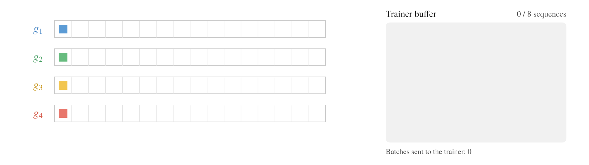
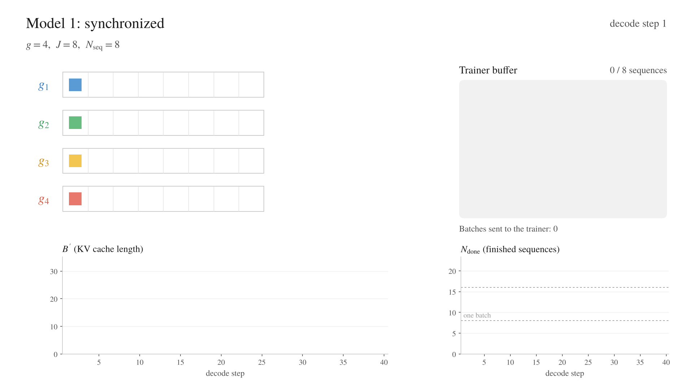
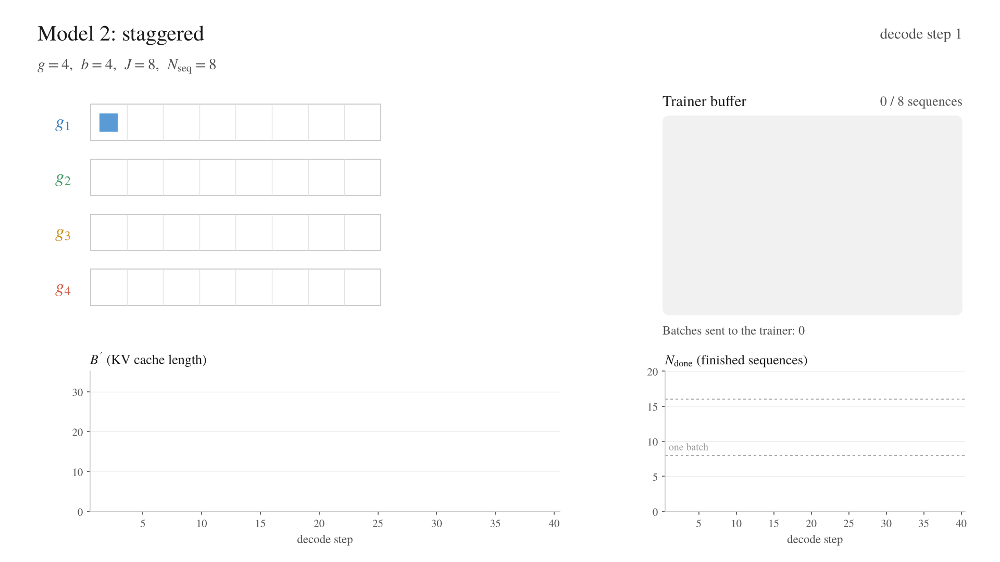
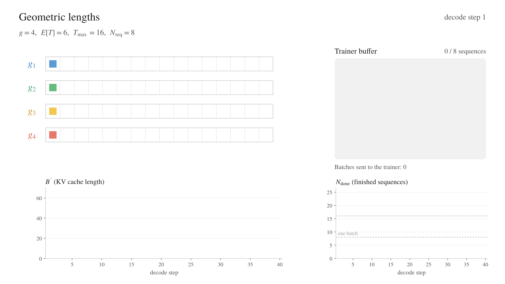
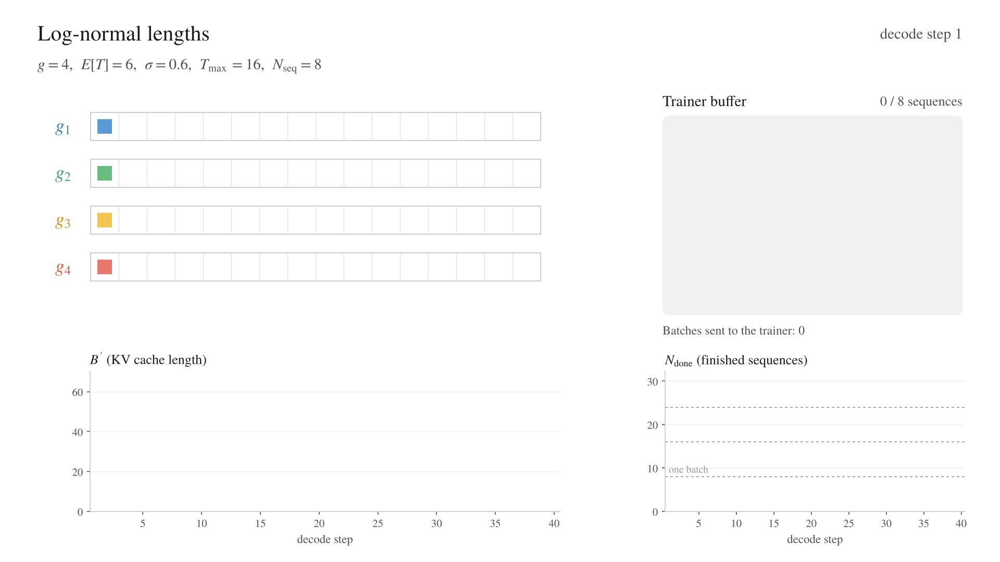
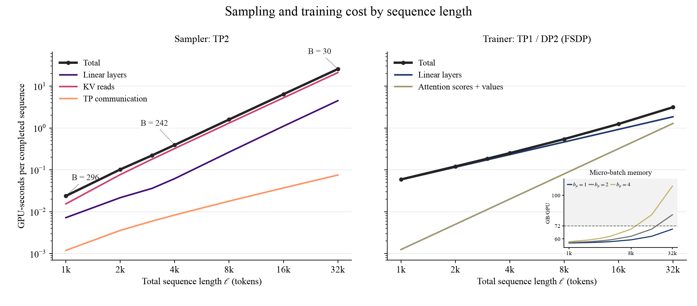
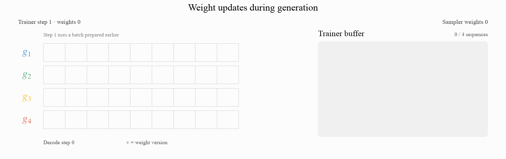
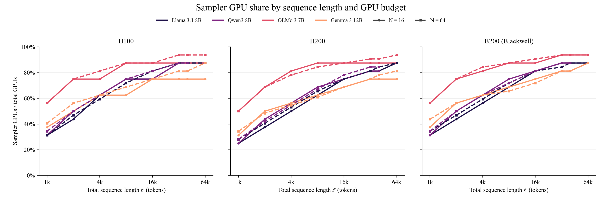
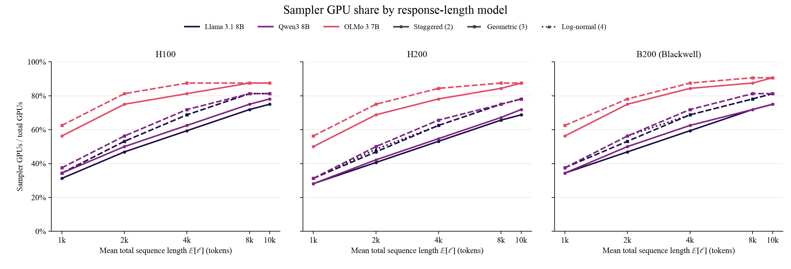

# An analytical model of (async) RL systems

*Prerequisites: you should be familiar with basic async RL (VR) terminology and concepts, roofline methodology from the [scaling book](https://jax-ml.github.io/scaling-book). The inference and training chapters are particularly relevant. You should be familiar with (Fully Sharded) Data, Tensor, Sequence Parallelism - (FS)DP, TP, SP.*

**Motivating question**
In (async) RL, the samplers generate rollouts while the trainer trains, on separate devices (GPU nodes). How to best split resources to keep the system busy while ensuring we don't drift too much off-policy ?

This document is a methodical guide to answer this question, using rooflines. The idea is that we want

1. $N_{\text{seq}}$ complete sequences are ready by the time the trainer starts working on a batch *(we assume the total number of tokens is random, $\approx N_{\text{tokens}}$ in expectation (see [Appendix 5](_appendix.md#finite-batches-token-budgets-and-grpo-groups)))*.
2. The estimated mean staleness stays at most $\eta$ (the policy version of the sampler can't be too far behind the trainer's).
3. Both trainer and sampler(s) fit in memory.

We build estimates of sampler and trainer runtimes (Sections 1 and 2) as well as policy staleness (section 3). Then we formulate GPU allocation between the trainer and sampler as a min-max optimization problem under constraints (GPU memory, staleness). Although we make some assumptions (no quantized inference nor real kernel efficiency...), the framework can naturally be extended to account for more realistic scenarios.

_The tone, structure, ideas and modeling arguments of this document are mine. Opus, Astra & Sol assisted in completing this work, see  [Appendix 1](_appendix.md#1-about-the-use-of-ai-assistants) for details._

<details open>
<summary><strong>Setup</strong></summary>

Our roofline analysis uses a gated MLP and GQA attention. [Appendix 2–4](_appendix.md#2-additional-setup-details) gives the exact setup and derivations.

| Symbol                                    | Meaning                                                                     |
| ----------------------------------------- | --------------------------------------------------------------------------- |
| $L, D, F$                                 | layers, hidden size, MLP size                                               |
| $N_Q, N_{KV}, d$                          | query heads, KV heads, head size; $D_Q = N_Q d$, $D' = N_{KV} d$            |
| $P_L = 3DF + 2D D_Q + 2D D'$, $P = L P_L$ | bf16 parameters (gated MLP, no embeddings), 2 bytes each                         |
| $\kappa = 4 L D'$                         | KV-cache bytes per token (K and V, all layers, bf16)                        |
| $C, W, \text{HBM}, W_{\text{ici}}$        | per GPU: peak FLOP/s, HBM bandwidth, HBM size, one-way NVLink bandwidth     |
| $W_{\text{link}}$                         | per GPU: inter-node bandwidth (50 GB/s below), used for the weight transfer |

*Notes*

- *H100 SXM numbers: $C\approx990$ TFLOP/s (dense BF16), $W$ = 3.35 TB/s, HBM = 80 GB, $W_{\text{ici}}$ = 450 GB/s, so $C/W \approx 295$*
- *Llama-3.1-8B: $P$ = 7.0B ($2P$ = 14 GB), $\kappa$ = 128 KiB per token.*
- ***In this simplified analysis, we do not include:** prefill (which can matter for long prompts), the LM head, runtime buffers, real kernel efficiency (we use peak rates), and the fixed latency of collectives. In most roofline metrics, we just sum the terms (no overlap between kernels).*

</details>

## 1. Sampler

> [!important] How long does it take to sample $N_{\text{seq}}$ sequences, and how much memory does it need?

### 1.1 Single decode step

A replica runs tensor parallelism (TP) over $n_{TP}$ GPUs and decodes $B$ sequences, one new token per sequence per step. $B'$ is the number of tokens in its KV cache. Here $n_{TP}$ is the sampler TP size, written $s$ when we compare both sampler and trainer GPU pools in Section 4.

**Time per step**
$$\boxed{T_{\text{step}}(B, B', n_{TP}) = L\max\Big(\underbrace{\frac{2BP_L}{n_{TP}C}}_{\text{linear layers: compute}},\ \underbrace{\frac{2P_L}{n_{TP}W}}_{\text{linear layers: weight read}}\Big) + \underbrace{\frac{\kappa B'}{n_{TP}W}}_{\text{attention: KV read}} + \underbrace{\frac{8LBD\,(n_{TP}-1)}{n_{TP}W_{\text{ici}}}}_{\text{TP all-reduces}}}$$

For long sequences, the KV cache limits the batch size, and KV reads can dominate decode time. The linear layers can become compute bound if the batch is large enough.

**Memory per GPU, at every step**
$$\boxed{\text{Mem}_{\text{samp}} = \frac{2P + \kappa B'}{n_{TP}} \le \text{HBM}}$$
With $n_{rep}$ replicas, the sampler uses $n_{\text{samp}} = n_{rep}\, n_{TP}$ GPUs.

Note that quantized weights reduce the weight-read term; a quantized KV cache reduces the cache-read term and cache memory and the compute throughput depends on the kernel.

Refer to [jax scaling book](https://jax-ml.github.io/scaling-book/inference/) (and [Appendix 3](_appendix.md#3-sampler-time-formula)) for derivations.

### 1.2 Arrival time

We know how to model the time per step, but, a priori, we don't know how many steps to run to get $N_\text{seq}$  complete sequences. We'll introduce arrival times and write the (approximate) sampler generation time 

#### Mental model

Decode is equivalent to:
- $B$ identical and independent data generators ($g=1,\dots,B$), each adding one token per step to its own buffer, in lockstep at clock $j=0,1,\dots$. The buffer contains the prompt and the generated tokens.
- When the EOS token arrives, generator $g$ clears its buffer, samples a new prompt $x\sim\mathcal D$ at the next step and continues generating. This is similar to _continuous batching_ (note that we treat prefill as instantaneous - see [Appendix 7](_appendix.md#7-assumptions-and-limitations)).



#### Formalism

**Arrival time for one generator**

For one newly started sequence, let $Y_t$ be its $t$-th generated token. Its response length (or arrival time) is the position of the first EOS (or its response-length cap):

$$
T:=\min\{t\ge1:Y_t=\text{<EOS>}\text{ or }t=T_{\max}\}.
$$

Here, $T_{\max}$ is the response-length cap ($=\infty$ if there is none).

In this document, we will use simplified models of **$T$**, although practical use cases would be better off with empirical measurements (see next steps)

**Arrival time of a batch**

For simplicity, we assume all prompts have the same length $|x|$ and consider the marginal distribution $P(T=t)=\mathbb E_x[P(T=t\mid x)]$.
Consider $B$ generators in one replica and let $y_{g,j'}$ be the token that generator $g$ emits at global step $j'$.
The number of complete sequences by step $j$ is

$$
N_{\text{done}}(j):=\sum_{g=1}^{B}\sum_{j'=0}^{j}\mathbf1_{\{y_{g,j'}=\text{<EOS>}\text{ or cap reached}\}}.
$$

A sequence is complete when it reaches EOS or the response-length cap and a batch is ready as soon as $N_{\text{seq}}$ sequences are done. Let

$$
J^*:=\min\{j:N_{\text{done}}(j)\ge N_{\text{seq}}\}.
$$

The time to sample a complete batch on this replica is

$$
T_{\text{sampler}}=\sum_{j=0}^{J^*}T_{\text{step}}\big(B,B'(j),n_{TP}\big)
=(J^*+1)T_{\text{step}}\left(B,\frac1{J^*+1}\sum_{j=0}^{J^*}B'(j),n_{TP}\right).
$$

*Note: this is simply because $T_{\text{step}}$ is affine in $B'$.*

The number of tokens in the batch is the random variable

$$
N_{\text{tok}}=\sum_{i=1}^{N_{\text{seq}}}(|x|+T_i),
$$

where $T_i$ is the response length of the $i$-th completed sequence selected for the batch.

**Steady-state assumption**

Assume that response lengths $T\stackrel{\mathrm{iid}}{\sim}p(T)$, with finite first and second moments.
In steady state, the current buffer lengths follow their asymptotic distribution. In any $n$ steps, the $B$ generators then complete the following number of sequences in expectation:

$$
\mathbb E\left[N_{\text{done}}(j+n)-N_{\text{done}}(j)\right]=\frac{nB}{\mathbb E[T]}.
$$

Note that equal-length generators can be periodic, so we use averages over periods.

Let $J_k^*:=\min\{j:N_{\text{done}}(j)\ge kN_{\text{seq}}\}$ be the step at which the $k$-th batch becomes available.
Each generator finishes one sequence every $\mathbb E[T]$ steps on average. The $B$ generators therefore finish $B/\mathbb E[T]$ sequences per step, so

$$
\lim_{k\to\infty}\frac{J_k^*}{k}=\frac{N_{\text{seq}}\mathbb E[T]}{B}.
$$

Let $S$ be the length of one generator's buffer, including the prompt. During a response of length $T$, that buffer has lengths $|x|+1,\dots,|x|+T$. Add these lengths over the response, then divide by the mean number of steps:

$$
\mathbb E[S]
=\frac{\mathbb E\left[\sum_{a=1}^{T}(|x|+a)\right]}{\mathbb E[T]}
=|x|+\frac{\mathbb E[T(T+1)]}{2\mathbb E[T]}.
$$

$N_{\text{seq}}\mathbb E[T]/B$ is the number of decode steps per batch in the long run, assuming no change in the policy or prompt distribution. With $n_{rep}$ independent replicas, the completion rate is multiplied by $n_{rep}$. The average sampling time for the pool is:

$$
\boxed{
\overline T_{\text{sampler}}
:=\frac{N_{\text{seq}}\mathbb E[T]}{n_{rep}B}
\underbrace{T_{\text{step}}\left(B,B\mathbb E[S],n_{TP}\right)}_{\mathbb E_{\text{stationary}}[T_{\text{step}}(B,B',n_{TP})]}.
}
\tag{Eq. 1.1}
$$

#### Memory

The time calculation uses the mean buffer length, but allocating memory requires the peak size (e.g. in the simplified models), or a specified high quantile of $B'$ to account for the distribution's tail:

$$
\mathbb P\left(B'>\frac{n_{TP}\,\mathrm{HBM}-2P}{\kappa}\right)\le\varepsilon.
$$

***For details on formalism, see [Appendix 5](_appendix.md#5-arrival-time-formalism).***

### 1.3 Simplified models of arrival time

Assume all prompts have the same length $|x|$. The times below are long-run/asymptotic averages, (excluding warm-up) and we are interested in both average memory and peak memory.

#### 1. Synchronized

All $B$ generators start together. Each response ends after exactly $J$ generated tokens, including EOS.

$$
T\sim\delta_J \implies
\mathbb E[T]=J \text{ and }
\mathbb E[S]=|x|+\frac{J+1}{2}.
$$

Substituting into Eq. 1.1 gives

$$
\overline T_{\text{sampler}}
=
\frac{N_{\text{seq}}J}{n_{rep}B}
\,
T_{\text{step}}\left(
B,B\left(|x|+\frac{J+1}{2}\right),n_{TP}
\right).
$$

The cache peaks when all sequences reach their last token:

$$
B'_{\max}=B(|x|+J).
$$

*An idealized baseline: real response lengths vary, so completions do not usually stay synchronized.*



#### 2. Staggered

Split the $B$ generators into $b$ equal groups, starting $J/b$ steps apart. Each response still lasts $J$ steps. Assume $b$ divides both $B$ and $J$.
$T \sim \delta_J$ so the steady-state sampling time is the same as Model 1.
The peak cache occupancy is smaller:

$$
B'_{\max}
=
B\left(|x|+J\frac{b+1}{2b}\right).
$$

Staggering spreads out completions and allows a larger batch. Each individual sequence still reaches $|x|+J$ tokens, but the sequences reach their maximum lengths at different steps.



#### 3. Geometric

Each unfinished response ends with a constant probability $p$ at each token.

$$
T\sim\operatorname{Geom}(p) \implies
\mathbb E[T]=\frac1p \text{ and }
\mathbb E[S]=|x|+\frac1p.
$$

Here, $T$ takes values in $\{1,2,\dots\}$. Substituting into Eq. 1.1 gives

$$
\overline T_{\text{sampler}}
=
\frac{N_{\text{seq}}}{p\,n_{rep}B}
\,
T_{\text{step}}\left(
B,B\left(|x|+\frac1p\right),n_{TP}
\right).
$$

There is no finite maximum cache size without a response-length cap. With $T\le T_{\max}$,

$$
B'_{\max}\le B(|x|+T_{\max}).
$$

A high quantile of $B'$ gives a less conservative memory budget.

*At the same mean response length $\mu$, the generated portion of the mean cache is $\mu$, compared with $(\mu+1)/2$ for equal lengths: about twice as large for long responses... a generator spends more steps on long sequences, so a random look at the cache finds them more often*



#### 4. Log-normal

Right-skewed distribution of response lengths. For long responses, we can use a continuous approximation:

$$
\log T\sim\mathcal N(m,\sigma^2),
\qquad
\mu:=e^{m+\sigma^2/2}.
$$

Ignoring integer-rounding errors,

$$
\mathbb E[T]\approx\mu,\qquad
\mathbb E[S]\approx |x|+\frac{\mu e^{\sigma^2}+1}{2}.
$$

Substituting into Eq. 1.1 gives

$$
\overline T_{\text{sampler}}
\approx
\frac{N_{\text{seq}}\mu}{n_{rep}B}
\,
T_{\text{step}}\left(
B,B\left(|x|+\frac{\mu e^{\sigma^2}+1}{2}\right),n_{TP}
\right).
$$

As with geometric lengths, there is no finite maximum without a length cap. With $T\le T_{\max}$, the same worst-case memory bound applies:

$$
B'_{\max}\le B(|x|+T_{\max}).
$$

Note: we could fit parameters to rollouts from the policy and prompt distribution being studied. [Sprint or Delve](https://ijcai.org/proceedings/2026/653) reports approximately log-normal reasoning lengths in its experiments.



#### Important notes

- The sampler's mean time only needs a few summary statistics: $\mathbb E[T]$, which sets the completion rate $B/\mathbb E[T]$ per replica per decode step, and $\frac{\mathbb E[T(T+1)]}{2\mathbb E[T]}$ the mean generated age in the cache. Add $|x|$ to obtain $\mathbb E[S]$. The trainer needs $\mathbb E[\ell]$ and $\mathbb E[\ell^2]$, where $\ell=|x|+T$ (next section). Memory requires a peak or a specified high quantile, rather than the mean alone.
- The geometric moments are uncapped, and the log-normal moments use a continuous approximation. The numerical applications use discrete capped laws and recompute their moments after applying the cap ([Appendix 5](_appendix.md#the-four-response-models)).
- We assume a fixed prompt distribution and response-length law. GRPO groups and changes during RL need additional treatment (see [Appendix 8](_appendix.md#8-extensions) for possible extensions).

[Appendix 5](_appendix.md#completion-and-cache-traces) shows the completion and cache traces.

## 2. Trainer
 > [!important] How long does one trainer step take, and how much memory does it need?

The trainer gets a batch of $N_{\text{seq}}$ complete sequences. Sequence $i$ has $\ell_i$ tokens (prompt + response), and $N_{\text{tok}} = \sum_i \ell_i$. It runs on $n_{\text{train}} = n_{DP}\, n_{TP}$ GPUs: FSDP over $n_{DP}$ ranks, plus TP + SP over $n_{TP}$ GPUs of one node only when one micro-batch does not fit. Here $n_{TP}$ is the trainer TP size, written $u$ in Section 4. By default, $n_{TP}=1$.

A micro-batch typically has thousands of tokens, so we assume training is compute bound, and we count FLOPs (we assume FSDP comms are hidden - with enough tokens in the batch).

**Time per training epoch**

We first count one epoch. Section 4 uses $T_{\text{train}}=n_{\mathrm{ep}}T_{\text{train}}^{(1)}$ for the repeated training passes.
$$\boxed{T_{\text{train}}^{(1)} = \frac{\overbrace{2c\,L\,P_{\text{MLP}}\,N_{\text{tok}}}^{\text{MLP}} + \overbrace{2c\,L\,P_{\text{attn}}\,N_{\text{tok}} + (2c+1)\,L\,D_Q\sum_i \ell_i^2}^{\text{attention: projections + scores}}}{n_{\text{train}}\,C} + \underbrace{\frac{8(c-1)\,N_{\text{tok}}\,L D\,(n_{TP}-1)}{n_{\text{train}}\,W_{\text{ici}}}}_{\text{TP + SP comms (0 without TP)}}}$$
with $P_{\text{MLP}} = 3DF$ and $P_{\text{attn}} = 2DD_Q + 2DD'$ the parameters per layer, so $P = L\,(P_{\text{MLP}} + P_{\text{attn}})$. With equal lengths, $\ell_i = |x| + J$.

- $c$ counts forward-equivalents: 3 for forward plus backward, and one more for full activation recompute. We use $c=4$. Any reference or old-policy forward computed once per fresh batch should be added separately, outside the epoch multiplier ([Appendix 4](_appendix.md#data-parallelism-tp-and-sp)).

- **Random token count:** With a fixed $N_{\text{seq}}$, $N_{\text{tok}}$ and $\sum_i \ell_i^2$ are random. $T_{\text{train}}^{(1)}$ is linear in both, so $\mathbb E[T_{\text{train}}^{(1)}] = T_{\text{train}}^{(1)}\big(N_{\text{seq}}\mathbb E[\ell],\ N_{\text{seq}}\mathbb E[\ell^2]\big)$

**Memory per GPU**, with $m$ tokens per micro-batch:
$$\boxed{\text{Mem}_{\text{train}} = \underbrace{\frac{16P}{n_{\text{train}}}}_{\text{weights, grads, Adam}} + \frac{\text{act}(m)}{n_{TP}} \le \text{HBM}}$$

- $16P$: BF16 weights and gradients, FP32 master weights and Adam moments, split across GPUs by FSDP.
- $a = 8D + 4D_Q + 4D' + 6F$: activation bytes per token and per layer, with FlashAttention
- Note that no recompute gives $c=3, act(m) = aLm$. Full recompute gives $c=4, act(m)=(2LD+a)m$ - we use full recompute in our memory model.


*Cost breakdown. Predicted cost per sequence for Llama 3.1 8B on H100, with 512-token prompts, equal response lengths and one training epoch. Longer responses increase KV reads and reduce the sampler batch that fits in memory. We show trainer memory for micro-batches of 1, 2 and 4 sequences; the dashed line is the 72 GB budget. Sampler TP2; trainer TP1 with two FSDP ranks.*

## 3. Weight updates and staleness

> [!important] Problem: the sampler always generates with old weights. How old?

After each trainer step, the trainer sends its new weights to the sampler. Here $n_{TP}=s$, the sampler TP size. Each sampler GPU receives its $2P/n_{TP}$ bytes and pauses for
$$T_{\text{sync}} = \frac{2P}{n_{TP}\,W_{\text{link}}}$$
_Note: For Llama-3.1-8B on one GPU per replica, this is 0.28 s over a 50 GB/s link. We assume the receiving link is the bottleneck, and all shards arrive in parallel._

An in-flight sequence has started generation but has not finished. With all generators busy, the sampler has $n_{rep}B$ unfinished sequences. Each completes at EOS or the response-length limit.

The sequences in flight keep their KV cache and go on with the new weights (as in [PipelineRL](https://arxiv.org/abs/2509.19128); further, we assume that we have instantaneous prefill)

Trainer step $k$ trains on batch $k$ and turns weights $k-1$ into weights $k$. A token generated with weights $v$ and used at step $k$ has staleness $(k-1)-v$.



*Weight updates and staleness. Four generators continue across weight updates while keeping their KV cache. Colors identify generators; each token records its weight version $v$. At trainer step 4, the trainer starts from weights 3, so token staleness is $3-v$, shown below each token. The long response contains tokens from several weight versions. Schematic example; only response tokens are shown.*

Let $T_{\text{cycle}} = \max(T_{\text{train}},\ T_{\text{sampler}} + T_{\text{sync}})$ be the time between two weight updates (Section 4). One cycle uses one weight version.

We assume the sampler completes $N_{\text{seq}}$ sequences per cycle: the number the trainer uses. If it completes more, the trainer stays fed, but the queue of finished sequences grows at each cycle, and so does the wait in it. With $\Delta$ extra sequences per cycle, batch $k$ waits about $k\Delta/N_{\text{seq}}$ cycles: the staleness grows without limit. The extra sequences are wasted (and so we should run fewer generators - see below).

The $n_{rep}B$ generators run in parallel. Each generator produces one response, then starts another when it finishes. On average, each completes $N_{\text{seq}}/(n_{rep}B)$ sequences per cycle. So a sequence stays in its generator for  
$$\boxed{\rho := \frac{n_{rep}B}{N_{\text{seq}}}}$$  
cycles on average. For example, with 2048 generators and 1024 completions per cycle, each sequence takes two cycles on average. No specific response-length model is needed. A sequence of length $T$ takes about $\rho\,T/\mathbb E[T]$ cycles.

$\rho$ does not depend on $T_{\text{cycle}}$. Faster or slower GPUs change the length of a cycle, not the number of cycles a sequence spans. In seconds, its mean generation time is $\rho\,T_{\text{cycle}}$.

Let $Q$ be the average number of finished sequences in the queue. With random lengths, the number of completions per cycle changes from cycle to cycle, and so does the queue length. We keep some completed sequences in the queue. The trainer can use them when too few new sequences finish. In the ideal equal-length staggered example, we take $Q=0$. The trainer takes $N_{\text{seq}}$ sequences from the queue per cycle, so a sequence waits $Q/N_{\text{seq}}$ cycles on average.

**During cycle $k-1$:**

- The trainer trains on batch $k-1$.
- The sampler finishes sequences for batch $k$, generating their last tokens with weights $k-2$.

With $Q = 0$, the last token of batch $k$ is already 1 version behind. With a reserve, it is $1 + Q/N_{\text{seq}}$ versions behind. The first token was generated earlier: about $\rho$ versions earlier on average.  
$$\boxed{\mathbb E[\text{first-token staleness}] \approx 1 + \frac{n_{rep}B + Q}{N_{\text{seq}}}}$$
To keep this estimated mean below $\eta$ (with $Q = 0$),  
$$1 + \frac{n_{rep}B}{N_{\text{seq}}} \le \eta \quad\implies\quad n_{rep}B \le (\eta-1)N_{\text{seq}}$$

A larger $B$ shares each weight read across more tokens. But at the same completion rate, it increases $\rho$: sequences take longer and span more weight updates. If the sampler has spare capacity, fewer busy generators reduce this delay: $\rho$ becomes $n_{rep}B_{\text{active}}/N_{\text{seq}}$. Keeping all generators busy and only adding pauses does not reduce $\rho$.

**Notes**

- The estimate is a mean, not a maximum. Long sequences can be much staler than the mean. A hard limit needs a rule to reject or restart sequences whose tokens become too old.
- In the fixed-duration example without sync or extra queueing, first-token staleness is at most $1+\lceil\rho\rceil$ ([Appendix 7](_appendix.md#fixed-duration-example-mean-and-maximum-staleness)).
- If generation time scales with response length and queue waiting is negligible, a rough estimate using the response-length percentile $T_{95}$ is
    $$\text{95th-percentile first-token staleness} \approx 1 + \rho\,\frac{T_{95}}{\mathbb E[T]}.$$
- The trainer sends new weights once per fresh batch, after all $n_{\mathrm{ep}}$ epochs. One epoch can have several optimizer steps. With more epochs, the weights can change more before the next transfer. For staleness in optimizer steps, count the steps between the two model versions ([Appendix 7](_appendix.md#epochs-and-publication-versions)).

Important note: rollout correction is outside this document. We assume a suitable method, but a staleness limit alone does not guarantee stable learning.

## 4. Feeding the trainer

> [!important] How should we split $N$ GPUs between the sampler and the trainer, within the memory and staleness limits?

We want the highest rate of fresh sequences that the sampler can generate and the trainer can train on. We are limited by the slowest of the two, so we get the optimization objective:

$$
\boxed{
\min_{B,\;n_{rep},\;s,\;n_{DP},\;u}
\max\left(T_{\text{sampler}}+T_{\text{sync}},\,T_{\text{train}}\right).
}
$$

Here, $B$ is the sampler batch size, $n_{rep}$ is the number of sampler replicas, $n_{DP}$ is the number of trainer DP replicas, and $s,u$ are their respective TP sizes. Thus $n_{\text{samp}}=n_{rep}s$ and $n_{\text{train}}=n_{DP}u$.

Each batch contains $N_{\text{seq}}$ fresh sequences. Training runs for $n_{\mathrm{ep}}$ epochs and publishes weights once per batch.

The allocation must satisfy:

$$
\begin{aligned}
n_{rep}s+n_{DP}u&\le N
&&\text{(C1) GPU budget}\\[6pt]
\frac{2P+\kappa B'_{\text{budget}}(B)}{s}&\le\mathrm{HBM}
&&\text{(C2) Sampler memory}\\[6pt]
\frac{16P}{n_{DP}u}+\frac{(2LD+a)M_{\mu}}{u}&\le\mathrm{HBM}
&&\text{(C3) Trainer memory}\\[6pt]
n_{rep}B&\le(\eta-1)N_{\text{seq}}
&&\text{(C4) Estimated mean staleness}\\[6pt]
B,n_{rep},n_{DP}&\ge1,\quad s,u\in\{1,2,4,8\}
&&\text{(C5) Allowed sizes and layouts.}
\end{aligned}
$$

**Assumptions**

- $\eta>1$ and TP stays within an eight-GPU node.
- TP sizes divide the KV-head count (and Q-head count as well). All four sizes satisfy this for the current model suite.
- The analytical solution allows continuous batch and replica counts; the numerical search uses integers.
- For random lengths (**Models 3–4**), use $B'_{\text{budget}}=B\,\mathbb E[S]+3\sqrt{B\,\operatorname{Var}(S)}$, assuming independent stationary slots. For staggered equal lengths (**Model 2**), use the mean $B\,\mathbb E[S]$; for synchronized lengths (**Model 1**), use the peak $B(|x|+J)$. The random reserve is an approximate quantile; the mean is not a guaranteed peak.
- Trainer memory assumes full activation recompute. $M_{\mu}$ is the token budget per micro-batch: for $b_{\mu}$ sequences sized at the maximum length, $M_{\mu}=b_{\mu}(|x|+T_{\max})$. The current numerical examples use $b_{\mu}=1$.
- From Section 3, $T_{\text{sync}}=2P/(sW_{\text{link}})$.

You can go straight to 4.2 for the result if you're not interested in the proof. The sketch is roughly: balance the two stage times to get a GPU split for a given $B$. Use memory and staleness constraints to find the feasible splits and batches, then choose the best batch. Finally, compare the supported TP layouts for the trainer and sampler.

### 4.1 Proof sketch

> [!note] We omit $T_{\text{sync}}$ in this proof sketch. The [full derivation with sync](_appendix.md#66-add-the-weight-transfer-pause) is similar in spirit, yet more technical.

<details>
<summary><strong>Proof sketch</strong></summary>

Set $T_{\text{sync}}=0$ and fix a TP pair $(s,u)$. The objective is now the cycle time, $T_{\text{cycle}}:=\max(T_{\text{sampler}},T_{\text{train}})$, so minimizing this quantity solves the problem (without weight sync).

From Sections 1–2:

$$
T_{\text{sampler}}
=\frac{N_{\text{seq}}}{n_{\text{samp}}}
\overbrace{
\mathbb E[T]\left[
\max\left(\frac{2P}{C},\frac{2P}{B\,W}\right)
+\frac{\kappa\,\mathbb E[S]}{W}
+\frac{8LD(s-1)}{W_{\text{ici}}}
\right]
}^{w_s(B)},
$$

$$
T_{\text{train}}
=\frac{N_{\text{seq}}}{n_{\text{train}}}
\overbrace{
n_{\mathrm{ep}}\left[
\frac{2cP\,\mathbb E[\ell]+(2c+1)LD_Q\,\mathbb E[\ell^2]}{C}
+\frac{8(c-1)LD\,\mathbb E[\ell](u-1)}{W_{\text{ici}}}
\right]
}^{w_t}.
$$

Thus $w_s(B)$ and $w_t$ are GPU-seconds per fresh sequence, with $\ell=|x|+T$ and $c=4$ for full recompute. We’ll use moments of the response-length distribution after applying its length cap.

**Step 1: Balance the stages**

In the continuous timing model, we can assign the remaining GPUs to training, so $n_{\text{train}}=N-n_{\text{samp}}$. Let $n_{\text{samp},0}(B)$ be the sampler count that balances the stages before applying the memory, staleness and minimum-pool constraints:

$$
\frac{w_s(B)}{n_{\text{samp},0}(B)}
=
\frac{w_t}{N-n_{\text{samp},0}(B)}.
$$

Solving gives

$$
\boxed{
n_{\text{samp},0}(B)
=N\frac{w_s(B)}{w_s(B)+w_t}.
}
\tag{4.1}
$$

**Step 2: Use constraints to find the feasible GPU pools**

Rearranging trainer memory **C3** gives

$$
\frac{16P}{n_{\text{train}}}
\le\mathrm{HBM}-\frac{(2LD+a)M_{\mu}}{u}
\quad\Longrightarrow\quad
n_{\text{train}}
\ge
\frac{16P}{\mathrm{HBM}-(2LD+a)M_{\mu}/u}.
$$

The denominator must be positive. **C5** also requires at least one trainer TP group, so

$$
\boxed{
n_{\text{train,min}}
=
\max\left(
u,\frac{16P}{\mathrm{HBM}-(2LD+a)M_{\mu}/u}
\right).
}
\tag{4.2}
$$

The GPU budget **C1** therefore leaves at most $N-n_{\text{train,min}}$ GPUs for sampling. Substituting $n_{rep}=n_{\text{samp}}/s$ into staleness **C4** gives another upper bound:

$$
\frac{n_{\text{samp}}B}{s}
\le(\eta-1)N_{\text{seq}}
\quad\Longrightarrow\quad
n_{\text{samp}}\le\frac{s(\eta-1)N_{\text{seq}}}{B}.
$$

Together,

$$
\boxed{
n_{\text{samp,max}}(B)
=
\min\left(
N-n_{\text{train,min}},
\frac{s(\eta-1)N_{\text{seq}}}{B}
\right).
}
\tag{4.3}
$$

At least one sampler replica is required by **C5**, so a feasible batch must allow

$$
s\le n_{\text{samp}}\le n_{\text{samp,max}}(B).
$$

**Step 3: Find the useful batch range**

Let $B_{\text{mem}}(s)$ be the largest batch satisfying sampler memory **C2**. Staleness **C4**, with at least one replica, also requires $B\le(\eta-1)N_{\text{seq}}$.

The sampler cost stops decreasing at the compute threshold $B=C/W$. Larger batches give no further throughput benefit and tighten the constraints. For the hardware considered here, $C/W>1$, so

$$
\boxed{
1\le B\le B_{\text{upper}}
:=
\min\left(
B_{\text{mem}}(s),
(\eta-1)N_{\text{seq}},
\frac{C}{W}
\right).
}
\tag{4.4}
$$

Discard TP pairs with $N<s+n_{\text{train,min}}$ or $B_{\text{upper}}<1$.

**Step 4: Choose the GPU split for a given $B$**

For any feasible batch size, **C1, C3–C5** give the sampler limits in Eq. 4.3. Combining these with the balanced count from Eq. 4.1 gives

$$
\boxed{
n_{\text{samp}}^*(B)=
\begin{cases}
s,
& n_{\text{samp},0}(B)<s,\\[3pt]
n_{\text{samp},0}(B),
& s\le n_{\text{samp},0}(B)\le n_{\text{samp,max}}(B),\\[3pt]
n_{\text{samp,max}}(B),
& n_{\text{samp},0}(B)>n_{\text{samp,max}}(B).
\end{cases}
}
\tag{4.5}
$$

Then $n_{\text{train}}^*(B)=N-n_{\text{samp}}^*(B)$.

**Step 5: Choose $B^*$**

For a given $B$, let $T_{\text{cycle}}^*(B)$ be the best feasible cycle time after choosing the GPU split. From the constraints above,

$$
\boxed{
\frac{T_{\text{cycle}}^*(B)}{N_{\text{seq}}}
=\max\left\{
\begin{aligned}
&\underbrace{\frac{w_s(B)+w_t}{N}}_{\text{total GPU budget}},\quad
\underbrace{\frac{w_s(B)}{N-n_{\text{train,min}}}}_{\text{trainer minimum}},\\[6pt]
&\underbrace{\frac{w_t}{N-s}}_{\text{one sampler TP group}},\quad
\underbrace{\frac{Bw_s(B)}{s(\eta-1)N_{\text{seq}}}}_{\text{staleness cap}}
\end{aligned}
\right\}.
}
\tag{4.5a}
$$

The cycle time is the largest of four bounds. Two decrease with $B$ (the GPU-budget and trainer-memory bounds), one stays constant (trainer capacity with one sampler TP group), and one increases: the staleness limit forces fewer sampler replicas as $B$ grows.

We calculate where the increasing bound meets each of the two decreasing bounds. Let $B_{\text{balance}}$ be the batch size at which the balanced sampler pool reaches the staleness limit:

$$
n_{\text{samp},0}(B_{\text{balance}})
=
\frac{s(\eta-1)N_{\text{seq}}}{B_{\text{balance}}}.
\tag{4.6}
$$

Using the later intersection, and keeping $B$ within Eq. 4.4, gives

$$
\boxed{
B^*
=
\min\left(
B_{\text{upper}},
\max\left(
1,\,
B_{\text{balance}},\,
\frac{s(\eta-1)N_{\text{seq}}}{N-n_{\text{train,min}}}
\right)
\right).
}
\tag{4.7}
$$

[Appendix 6.5](_appendix.md#65-optimal-batch-without-sync) derives the two intersections and gives the quadratic expression for $B_{\text{balance}}$. If the constant trainer-capacity bound dominates, several batch sizes can give the same optimal time; Eq. 4.7 still gives one optimum.

**Step 6: Compare the TP pairs**

For each feasible pair with $s,u\in\{1,2,4,8\}$, calculate $B^*$ with Eq. 4.7 and the GPU split with Eq. 4.5. Evaluate the two stage times and keep the allocation with the smallest cycle time. There are at most 16 TP pairs.

For the selected allocation, the optimal sampler-to-trainer GPU ratio and sampler share are

$$
\boxed{
r_{\text{GPU}}^*
=\frac{n_{\text{samp}}^*}{N-n_{\text{samp}}^*},
\qquad
\frac{n_{\text{samp}}^*}{N}
=\frac{r_{\text{GPU}}^*}{1+r_{\text{GPU}}^*}.
}
\tag{4.8}
$$

The appendix gives the [full solution with weight sync](_appendix.md#66-add-the-weight-transfer-pause) and the [integer allocation procedure](_appendix.md#68-integer-procedure-and-interpretation).

</details>

### 4.2 Application

Companion code: [integer allocation](../src/allocation.py) and [continuous allocation](../src/continuous_allocation.py).

Concretely, once we fix the model, GPU type and constraints, we give the solver $N$, a response-length distribution and the allowed TP layouts. It calculates an optimal continuous batch size and GPU split, compares the TP pairs, and returns the allocation.

From the repository root, run the [continuous solver](../src/continuous_allocation.py):

```python
from continuous_allocation import continuous

result = continuous(
    n_gpus=32,
    model="Llama-3.1-8B",
    hardware="H100",
    arrival="geometric",
    mean_response=2048,       # Mean after applying the cap
    max_response=8192,
    prompt_tokens=512,
    n_sequences=1024,        # Fresh sequences per training batch
    epochs=1,
    mean_staleness_limit=8,
    memory_fraction=0.9,
    sampler_tp=(1, 2, 4, 8),
    trainer_tp=(1, 2, 4, 8),
    weight_sync=False,       # Matches the proof sketch
)

if not result["feasible"]:
    raise ValueError("No allocation satisfies the constraints.")

for key in (
    "sampler_gpus", "trainer_gpus",
    "sampler_tp", "trainer_tp",
    "batch_per_replica", "sequences_per_second",
):
    print(f"{key}: {result[key]:.3f}")
```

This example gives approximately 19 sampler GPUs and 13 trainer GPUs, with sampler TP2, trainer TP1 and $B=295.4$ per sampler replica. The matched integer solution uses 18 sampler and 14 trainer GPUs, $B=296$, and about 78.7 fresh sequences/s: 5.2% below the continuous prediction.

### 4.3 Numerical applications

These examples use integer GPU counts and include weight sync. For Gemma and OLMo, the code accounts for their local-attention windows ([Appendix 3](_appendix.md#local-attention-layers)).

Figure 1 shows how longer responses generally shift the allocation toward sampling.


*Figure 1. Equal-length staggered responses (Model 2). Color identifies the model; solid lines use 16 GPUs and dashed lines use 64. Shared settings: BF16, 512-token prompts, one epoch, 1,024 fresh sequences per batch, estimated mean-staleness budget $\eta=8$, ideal stage costs and 90% HBM. Staggered cache uses its mean. Qwen ends at 40,960 tokens; k = 1,024.*

**Sampler GPU share by response-length model**
Figure 2 shows the difference in allocation between a geometric and staggered arrival law - for Llama/H100 at 8k, it goes from 70% to 80% due to the long tails of KV cache. Note that the same GPU ratio can hide meaningful throughput differences.
For Llama/H100 at 32k with $N=32$, geometric and staggered lengths have the same split but the former only has half the throughput (see [throughput difference](../figs/main/response-length-throughput.png)).

*Figure 2. Llama, Qwen and OLMo with $N=64$, comparing staggered, geometric and log-normal lengths (Models 2–4). Other settings match Figure 1. Random laws are tuned after capping at $4\mathbb E[T]$; log-normal $\sigma=1$. Random cache uses mean plus three standard deviations. All curves stop at 10k mean total tokens to keep the response cap, $4\mathbb E[T]$, within Qwen's 40,960-token context limit. Each point reoptimizes $B$, TP and the GPU split.*

**Limits:** These predictions use ideal stage costs, one sequence per training micro-batch, perfectly balanced trainer work, hidden FSDP communication; no efficiency correction, prefill and reference-policy passes. The $\eta=8$ estimated-mean budget is illustrative; it is not directly equivalent to a published maximum-staleness setting.

## Conclusion

We present a first-principles-based method to allocate an (async) RL system. Longer responses generally move GPUs toward sampling, yet the response-length law meaningfully changes cache occupancy and training work.

In practice, inference often uses [quantized kernels](https://nvidia.github.io/TensorRT-LLM/1.1.0/features/quantization.html). These examples use BF16. Quantized weights or a [quantized KV cache](https://github.com/vllm-project/vllm/blob/main/docs/features/quantization/quantized_kvcache.md) can reduce memory use and sampling time, so they can change the GPU split. The gain depends on the kernels and hardware.

**These are predictions under a simplified model. The useful result is a method for choosing a starting allocation. Measure $T_{\text{sampler}}$ and $T_{\text{train}}$ on the intended workload, assess staleness based on the empirical distribution of response lengths (and expected future responses)  and then compare nearby feasible splits.**

## Next steps
- Empirical validation and measurement ($T_{\text{train}}$ and $T_{\text{sampler}}$) to account for real system efficiency (planned... come back in about a week)
- Empirical response length measurements and evolution in RL phases (planned).
- Modern architectures,  long context which change the theoretical and empirical dynamics (what would make this really applicable).
- More extensions are documented in [Appendix 8](_appendix.md#8-extensions).